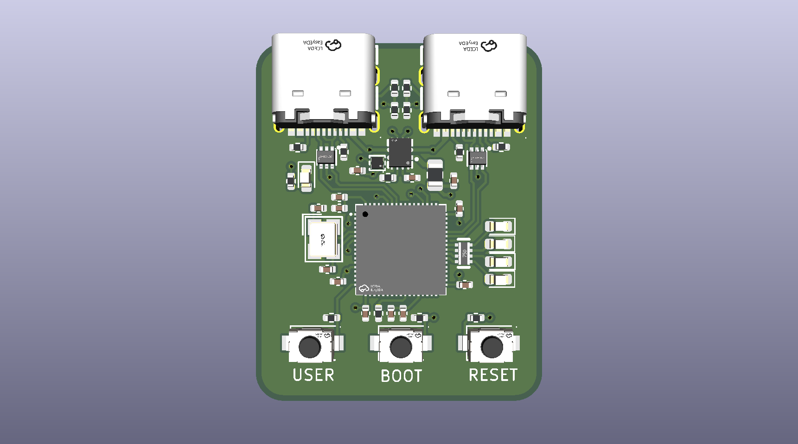

# USBnet

USBnet tunnels TCP connections between two computers over a single CH32V467WEU6 board. Plug the board into both computers with USB. The client exposes a local HTTP proxy and the server opens upstream TCP connections to the open internet.

[](images/usbnet.png)

## Why?

So... Did you notice that some computers have strict policies to avoid connecting USB devices except allowed ones such as keyboards and mice? What if we take advantage of the HID protocol inside these devices to send network packets? A translator would be required (the client and the server) but it is technically possible... Introducing... USBnet! Networking via USB (even if the USB device emulates a mouse) :D

## Host tool

```sh
uv sync --project usbnet
uv run --project usbnet usbnet --server   # on the server computer
uv run --project usbnet usbnet --client   # on the client computer
```

Point the client computer's proxy at `127.0.0.1:8080`.

## Modes

The client port can work in two ways. You pick one with `--config` (`--mode relay` or `--mode custom`), and `--client` figures out which one is active on its own.

- **Relay** (`relay`): the default. The board shows up as a USBnet device with a bulk endpoint. Fastest option.
- **Emulated** (`custom`): the board pretends to be another device, like a mouse or keyboard you cloned. The computer only sees that device, and the tunnel goes through a hidden HID feature report. Slower, but it blends in.

## Configuration

Hold the **USER** button while resetting to enter configuration mode. A USB interface should then appear as **USBnet Configuration** (`1a86:fe53`). Use `--config` to edit the profile stored in flash:

```sh
uv run --project usbnet usbnet --config list            # board and HID devices available to clone
uv run --project usbnet usbnet --config get             # print the stored profile
uv run --project usbnet usbnet --config clone 0 --preset mouse
uv run --project usbnet usbnet --config set --mode custom --preset keyboard
uv run --project usbnet usbnet --config set --defaults --yes
```

## Speed

Rough numbers from my tests. Yours may vary.

| Mode | Download | Upload | Ping (idle / loaded) |
| --- | --- | --- | --- |
| Relay | ~90 Mbps | ~88 Mbps | 3 / 4 ms |
| Emulated | ~25 Mbps | ~21 Mbps | 29 / 33 ms |

Relay is measured over a local link, so it's mostly the tunnel itself. Emulated is over the internet (speedtest.net), so it includes the line.


## Building

Download WCH's RISC-V toolchain from [MounRiver](https://www.mounriver.com/download) and put it under `toolchain/riscv32-wch-elf-gcc15`, or point `TOOLCHAIN_DIR` at another install.

```sh
make -C ch32v467
make -C ch32v467 test
```

## Tests

`make -C ch32v467 test` builds a hardware-test image. On reset it lights LED1–LED4 in order, then holds them on. Each LED maps to a function:

| Part | CH32V467 pin | Meaning |
| --- | --- | --- |
| LED1 | PA9 | Firmware heartbeat |
| LED2 | PA8 | USB1 enumerated |
| LED3 | PB10 | USB2 enumerated |
| LED4 | PB11 | USER pressed |

All four LEDs blinking together indicate firmware initialization failure.

## Flashing

Hold BOOT0 (PE12) while resetting, then flash with WCHISPTool_CMD v4.0:

```sh
WCHISPTool_CMD -p 0x00130000 -c ch32v467/CH32V467WEU6-isp.ini -o program -f ch32v467/build/ch32v467.bin
WCHISPTool_CMD -p 0x00130000 -c ch32v467/CH32V467WEU6-isp.ini -o verify -f ch32v467/build/ch32v467.bin
```

The board stays in the bootloader after flashing, so reset it (or replug) to start the new firmware.